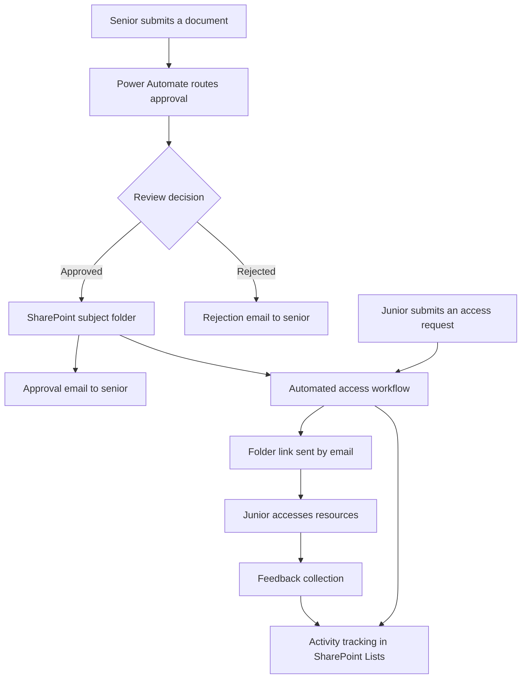
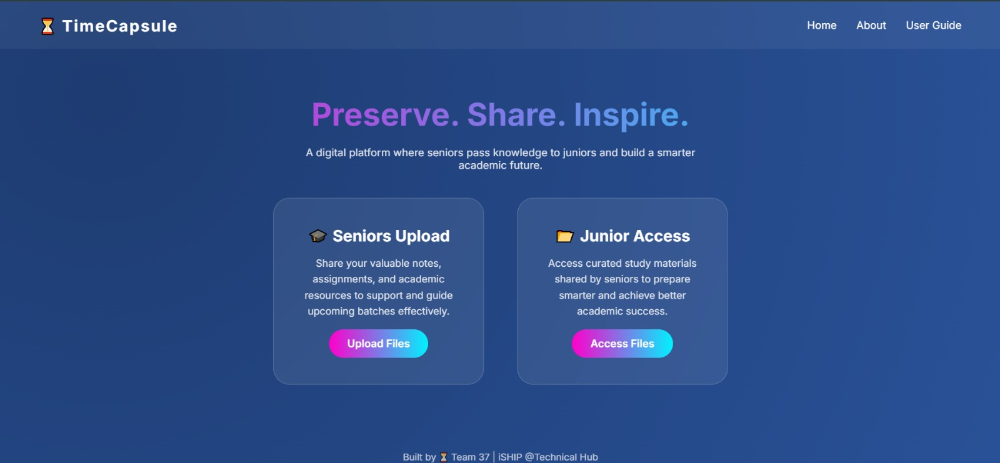

<div align="center">


# TimeCapsule
### Unlock the Past, Ace the Future.

**One generation’s knowledge. Another’s opportunity.**

An academic knowledge-sharing platform that connects senior contributions  
with junior learning through Microsoft 365 workflow automation.

[](https://lokeshkodamanchili.github.io/TimeCapsule/)
[](#see-it-in-action)


[The idea](#the-idea) · [Experience](#choose-your-path) · [Workflow](#from-contribution-to-learning) · [Project library](#explore-the-project-library) · [Team](#the-people-behind-timecapsule)

</div>

---

## The idea

### Preserve. Share. Inspire.

Useful notes, assignments, and study resources should keep helping students long after a batch moves on. **TimeCapsule** gives that knowledge a structured path forward: seniors contribute materials, submissions pass through approval, and juniors request access to organized subject folders.

Developed under the **iSHIP program at Technical Hub**, the project combines a public website with Microsoft Forms, Power Automate, SharePoint, Excel, and Outlook to support academic knowledge transfer.

> **The goal:** turn individual academic effort into a resource that future batches can build on.

## Designed around the learning journey

| Capability | What it brings to the experience |
| :--- | :--- |
| **Senior contributions** | A dedicated form for sharing notes, PDFs, assignments, and academic resources. |
| **Approval workflow** | Power Automate routes submissions for review before approved materials enter the collection. |
| **Subject-wise organization** | SharePoint folders keep approved resources arranged by subject. |
| **Junior access requests** | A separate form starts the process of receiving a resource-folder link by email. |
| **Email communication** | Approval, rejection, and access messages keep students informed. |
| **Feedback and tracking** | Feedback collection and SharePoint Lists support activity monitoring. |
| **Responsive web entry point** | Home, About, and User Guide views bring the project and its two user journeys together. |

## Choose your path

**Use your Aditya college email account**, as instructed in the website’s User Guide. Form availability and resource access depend on the institution’s Microsoft 365 permissions.

### 01 / Contribute as a senior

1. Open the **Senior Upload Form** from the live website.
2. Enter the subject details and upload your academic document.
3. Submit the form for review.
4. Receive an approval or rejection notification by email.
5. Approved resources are stored in the appropriate subject folder.

**[Open TimeCapsule → Upload Files](https://lokeshkodamanchili.github.io/TimeCapsule/)**

### 02 / Learn as a junior

1. Open the **Junior Access Form** from the live website.
2. Submit the required details and access request.
3. Receive the SharePoint folder link by email.
4. Open the available study materials and submit feedback.

**[Open TimeCapsule → Access Files](https://lokeshkodamanchili.github.io/TimeCapsule/)**

## From contribution to learning



### Technology with a clear purpose

| Layer | Technology | Responsibility |
| :--- | :--- | :--- |
| Web experience | **HTML5 · CSS3 · JavaScript** | Responsive interface, view switching, and links to the student forms. |
| Data collection | **Microsoft Forms** | Senior submissions, junior requests, and feedback. |
| Workflow orchestration | **Power Automate** | Approval routing, document processing, and automated communication. |
| Resource storage | **SharePoint** | Document libraries and subject-wise folders with configured access. |
| Records and tracking | **Excel · SharePoint Lists** | Supporting records and activity logs. |
| Notifications | **Microsoft Outlook** | Review outcomes and resource-access emails. |
| Website hosting | **GitHub Pages** | Public access to the project website. |

> **Deployment scope:** this repository contains the static website and supporting project materials. The Microsoft 365 forms, flows, storage, and permissions operate in the institution’s environment. Cloning the repository does not provision those services.

## See it in action

| Journey | Watch the demonstration | Explore the implementation |
| :--- | :--- | :--- |
| **Senior contribution** | [Senior Flow · PC View](Video%20Demo/PC%20View/Seniorflow.mp4) | [Senior automation screenshot](assets/PowerAutomate/senior%20flow.png) |
| **Junior access** | [Junior Flow · PC View](Video%20Demo/PC%20View/Juniorflow.mp4) | [Junior automation screenshot](assets/PowerAutomate/junior%20flow.png) |
| **Feedback** | [Feedback form](assets/Forms/feedback%20form.png) | [Feedback automation screenshot](assets/PowerAutomate/feedback%20flow.jpeg) |

<details>
<summary><strong>Explore the visual walkthrough</strong></summary>

### Website preview

The repository includes this website preview image. For the current interface, visit the [live website](https://lokeshkodamanchili.github.io/TimeCapsule/).



### Contribution and access forms

| Senior submission | Junior request |
| :---: | :---: |
|  |  |

### Storage and communication

| Subject folders | Access notification |
| :---: | :---: |
|  |  |

</details>

## Explore the project library

| Location | What you will find |
| :--- | :--- |
| [`index.html`](index.html) | Complete website with embedded CSS and JavaScript. |
| [`Documentation/`](Documentation/) | Project report and presentation deck. |
| [`Video Demo/PC View/`](Video%20Demo/PC%20View/) | Recorded senior and junior workflow demonstrations. |
| [`assets/Forms/`](assets/Forms/) | Submission, access, and feedback form screenshots, plus QR codes. |
| [`assets/PowerAutomate/`](assets/PowerAutomate/) | Senior, junior, and feedback flow screenshots. |
| [`assets/SharePoint/`](assets/SharePoint/) | Storage, folder organization, access, Excel data, and list screenshots. |
| [`assets/outlook/`](assets/outlook/) | Approval requests, outcomes, and access email examples. |
| [`assets/Images/`](assets/Images/) | Branding, website preview, team, mentors, and presentation photos. |

**Go deeper:** [Project documentation · PDF](Documentation/Project%20documentation.pdf) · [Presentation · PowerPoint](Documentation/TimeCapsule-Unlock-the-Past-Ace-the-Future%20%281%29.pptx) · [Form QR codes · PDF](assets/Forms/QR%20CODES.pdf)

## Preview the website locally

No package installation or build step is needed for the static website.

```bash
git clone https://github.com/lokeshkodamanchili/TimeCapsule.git
cd TimeCapsule
python -m http.server 8000
```

Open **http://localhost:8000** in your browser. You can also open `index.html` directly.

The forms and SharePoint resources still require the appropriate institutional account and permissions.

## The people behind TimeCapsule

### Team 37 · iSHIP @ Technical Hub

| Team member | Contribution |
| :--- | :--- |
| **Karri Karthik Raju** | Senior Flow Development |
| **Kodamanchili Sri Satya Lokesh** | Junior Flow Development |
| **Kankatala Madhurima** | SharePoint Management |
| **Billakurthi Varshitha** | Forms Creation |
| **Malla Charmi** | Senior Testing & Validation |
| **Narla Veera Venkata Suryanarayana** | Junior Testing & Validation |

<div align="center">


**Built through collaboration. Designed to keep knowledge moving.**

</div>

<details>
<summary><strong>Project moments and acknowledgements</strong></summary>

Developed as part of the **iSHIP program at Technical Hub**, with appreciation for the mentorship and learning environment that supported the project.

[Meet the mentors](assets/Images/Mentors.jpg) · [Project chart presentation](assets/Images/project%20chart%20presentation.jpg) · [Team 37](assets/Images/team%2037.jpg) · [iSHIP](assets/Images/iship.jpg)

</details>

## Connect and collaborate

Have feedback, a question, or an idea for improving academic resource sharing?

**[Email the project contact](mailto:satyalokesh970@gmail.com)** · **[Open an issue](https://github.com/lokeshkodamanchili/TimeCapsule/issues)**

**Usage request:** please obtain permission from the project team before using or referencing this project.

---

<div align="center">

### Share what you learned. Shape what comes next.

**TimeCapsule — Unlock the Past, Ace the Future.**

[Explore the platform ↗](https://lokeshkodamanchili.github.io/TimeCapsule/) · [Back to top ↑](#timecapsule)

</div>
